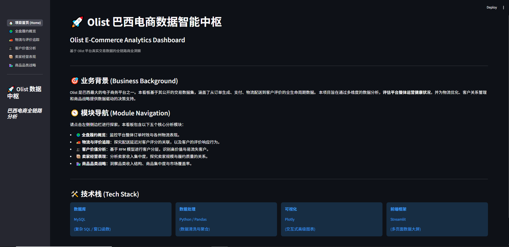
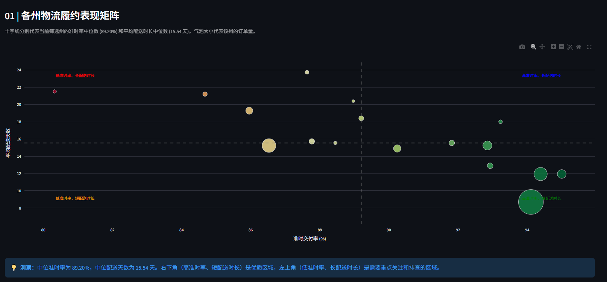
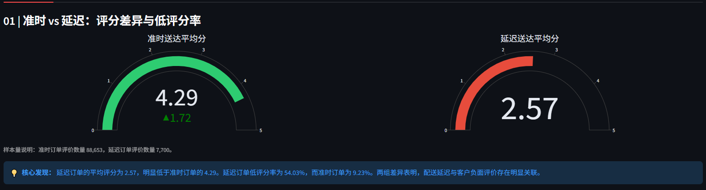
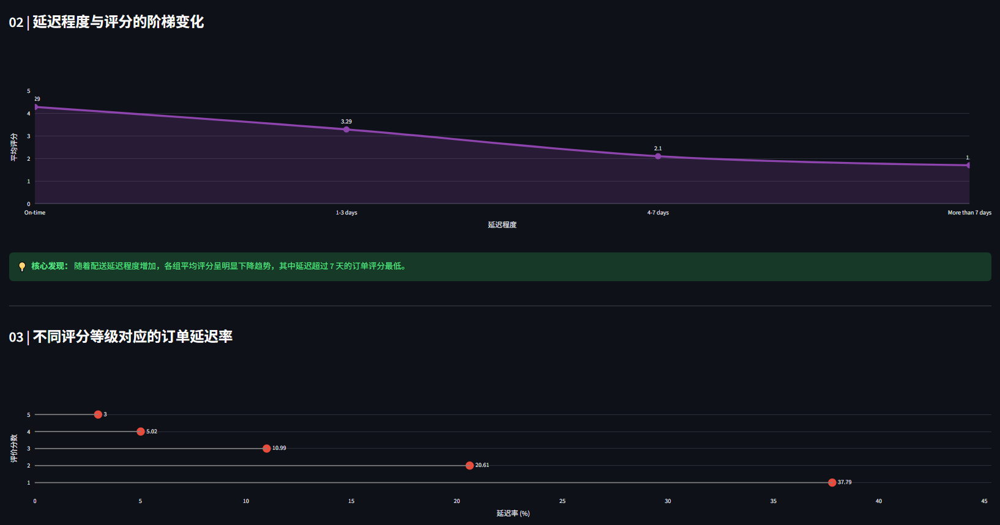
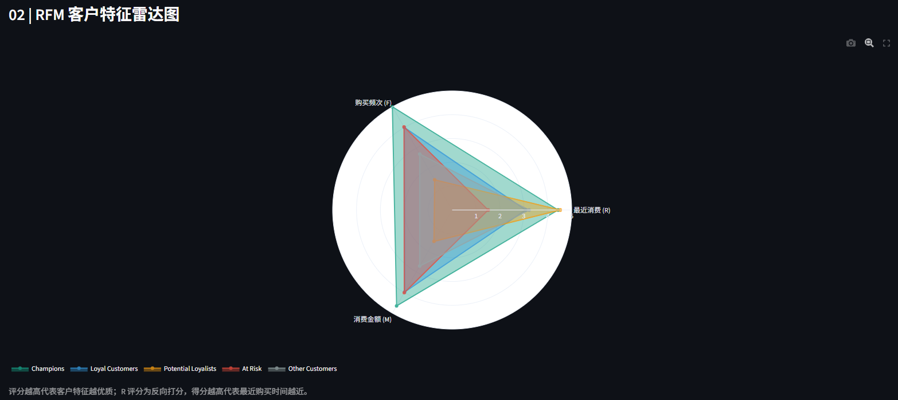
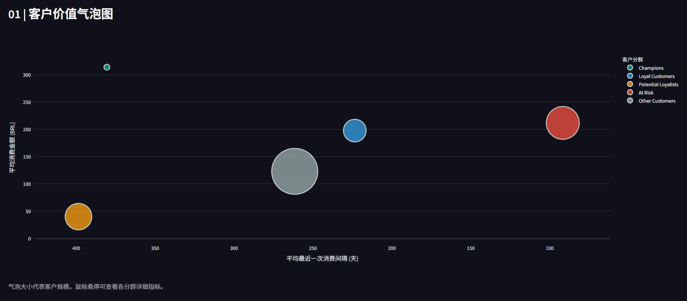
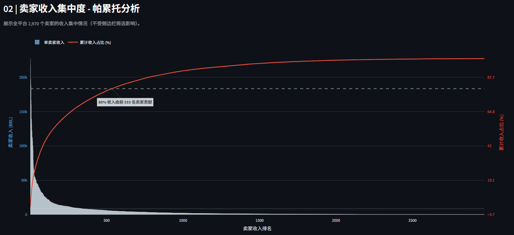
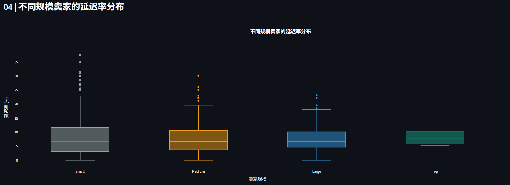
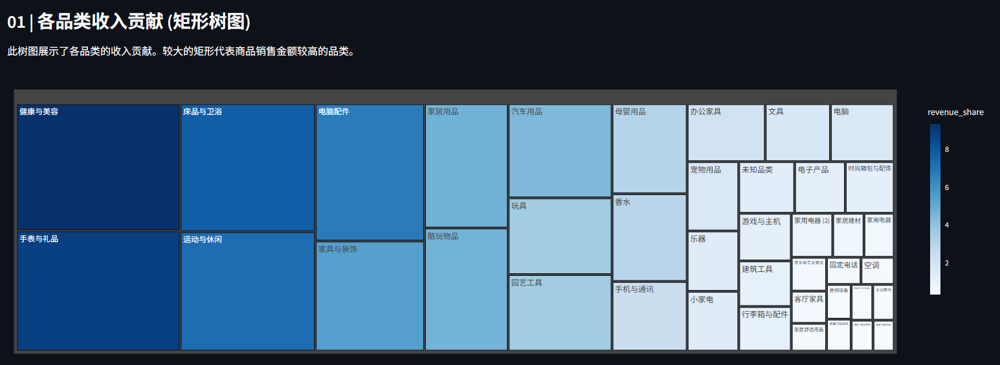
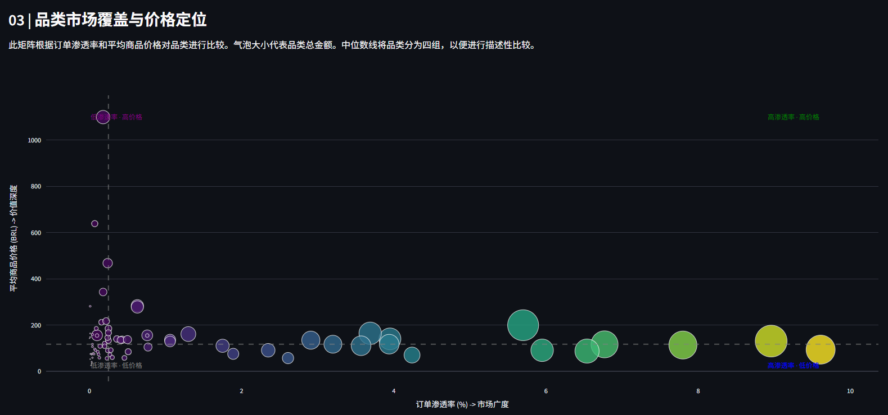

# 🚀 Olist 巴西电商数据全链路分析与交互式大屏


## 📖 项目简介 (Project Overview)
本项目基于 Kaggle 上真实的 **Olist 巴西电商数据集**，构建了一套端到端的商业数据科学工作流。涵盖了从 **底层 MySQL 数仓建模、复杂窗口函数聚合、Python 数据清洗与统计检验（SciPy），到最终产出 Plotly 交互式图表与 Streamlit 多页面数据大屏** 的完整闭环。

## 🌐 在线演示 (Live Demo)
👉 **[点击此处体验完整的交互式数据大屏](#)** *(⚠️ 待你在 Streamlit Cloud 部署后，将链接填在这里)*



---

## 📂 项目结构 (Repository Structure)

```text
📦 Olist-Ecommerce-Analysis
 ┣ 📂 dashboard             # Streamlit 交互式大屏代码
 ┃ ┣ 📜 app.py              # 主入口与路由
 ┃ ┣ 📜 Home.py             # 封面首页
 ┃ ┗ 📜 [各模块].py         # 五大分析模块页面代码
 ┣ 📂 data
 ┃ ┣ 📂 raw                 # 原始 CSV 数据 (未上传，需自行下载)
 ┃ ┗ 📂 processed           # SQL 导出的分析级 CSV 宽表
 ┣ 📂 notebooks             # Jupyter EDA 探索与分析代码
 ┣ 📂 sql                   # 核心 SQL 脚本
 ┃ ┣ 📜 00_prepare.sql      # 建表与数据导入
 ┃ ┗ 📜 01~05_build.sql     # 各模块指标构建脚本
 ┣ 📂 Dashboard_Screenshots # README 引用的大屏截图
 ┣ 📜 requirements.txt      # 依赖清单
 ┗ 📜 README.md
```

## ⚠️ 数据口径与假设 (Data Assumptions)
为了保证分析的严谨性，本项目在数据清洗和聚合阶段遵循以下业务口径：
1. **有效订单**：仅统计状态为 `delivered`（已送达），且实际送达时间与预计送达时间均不为空的订单。
2. **收入口径**：项目中提及的“收入/金额”均指商品交易总额 (GMV)，**不含运费**，且由于原始数据缺失，不代表平台净利润。
3. **延迟定义**：实际送达时间 `order_delivered_customer_date` > 预计送达时间 `order_estimated_delivery_date`。
4. **RFM 打分**：基于分位数（NTILE 5）将客户 R、F、M 值转化为 1-5 分，R 值越小得分越高。

---

## 📊 核心业务洞察 (Business Insights)

### 1. 🌍 全盘履约：物流网络的“地域折叠”
平台有效送达订单共 96,470 笔。平均配送时长为 **12.50 天**，整体准时交付率 **91.89%**。通过物流履约矩阵发现，东南部（如 SP 州）呈现高订单量、高准时率、短配送时长的“优质区”特征；而东北部（如 AL、MA）则陷入低准时率且长配送时长的“重灾区”。
> **💡 建议**：对东北部重灾区需立刻排查是干线物流太慢还是末端爆仓，针对性增加区域仓储。



<details>
<summary>👉 展开查看：各州准时率 Top 10 与 Bottom 10</summary>
<br>


</details>

---

### 2. 🚚 物流时效：配送延迟是客户体验的“绝对杀手”
*   **评分断崖**：准时送达订单的平均分高达 **4.29 分**，而延迟送达骤降至 **2.57 分**。
*   **差评危机**：延迟订单的低评分率（1-2星）高达 **54.03%**，是准时订单（9.23%）的 **5.8 倍**。
*   **情绪响应**：客户在极短时间（<1天）内提交的差评率异常偏高（情绪驱动），而延迟程度越深（>7天），评分跌得越惨。从评分反查，1 星评价的订单延迟率高达 37.79%。



<details>
<summary>👉 展开查看：延迟阶梯惩罚与响应行为分析</summary>
<br>


</details>

---

### 3. 💎 客户价值：极度依赖“一次性买家”
*   **留存危机**：平台高达 **97.00%** 的用户为“一次性买家”（仅购买一次），复购率极低。
*   **高净值流失**：RFM 雷达图显示，**At Risk** 群体近期购买得分极低，但历史消费金额极高。这 14.55% 的流失客群，曾贡献了全盘 **28.59%** 的营收，急需紧急召回。



<details>
<summary>👉 展开查看：客户群体气泡图与占比</summary>
<br>


</details>

---

### 4. 📦 卖家表现：极端的“二八定律”
*   **头部聚集**：帕累托图揭示，仅仅 **1%** 的头部卖家贡献了 **25.93%** 的营收；前 **20%** 的卖家贡献了高达 **82.29%** 的总收入。
*   **规模与质量脱钩**：通过统计学检验验证（Spearman 秩相关 ρ=0.0825；Kruskal-Wallis 检验 p=0.25），发现**卖家订单规模与配送延迟率之间并无显著关联**。大卖家的物流表现并不比小卖家具备压倒性优势。



<details>
<summary>👉 展开查看：卖家规模分布与统计学检验结论</summary>
<br>


</details>

---

### 5. 🛍️ 商品品类：流量基本盘与利润款双轮驱动
*   **头部集中**：健康美容（Health & Beauty）、手表礼品（Watches & Gifts）和床品卫浴（Bed Bath Table）构成了平台的营收基本盘。
*   **战略定位**：通过渗透率与客单价四象限矩阵分析，床品/美妆属于高渗透、低价格的“引流款”；而电脑/乐器属于低渗透、高价格的“利润款”。



<details>
<summary>👉 展开查看：品类市场覆盖与价格定位四象限矩阵</summary>
<br>


</details>

---

## 🚀 如何本地运行复现 (How to Run)

### 1. 环境准备
```bash
git clone https://github.com/你的用户名/Olist-Ecommerce-Analysis.git
cd Olist-Ecommerce-Analysis
pip install -r requirements.txt
```

### 2. 数据准备与入库
1. 从 [Kaggle Olist 数据集](https://www.kaggle.com/datasets/olistbr/brazilian-ecommerce) 下载原始 9 个 CSV 文件。
2. 将原始 CSV 放入 `data/raw/` 目录。
3. 在本地 MySQL 中运行 `sql/00_prepare.sql` 建库建表。
4. 运行 `notebooks/explore_data.py`（或相关入库脚本），将原始数据导入 MySQL。

### 3. 生成数据宽表
依次运行 `sql/queries/` 目录下的 `01_build.sql` 到 `05_build.sql`，在 MySQL 中生成分析宽表。
运行 `python_file/export_tables.py`，将宽表导出至 `data/processed/` 目录。

### 4. 启动交互式大屏
```bash
streamlit run dashboard/app.py
```

## ⚠️ 局限与展望 (Limitations & Future Work)
- **相关不等于因果**：物流延迟与差评高度相关，但无法排除商品质量、客服态度等其他因素。
- **数据缺失**：原始数据集未包含商品采购成本、平台运营成本等财务数据，因此无法进行真正的利润率和 ROI 分析。
- **未来展望**：后续可引入机器学习模型（如 XGBoost、K-Means 聚类）进行更精细的客户生命周期价值（CLV）预测及流失预警。

## 👤 联系方式 (Contact)
- **Author**: [fengyu]
- **Email**: [fengyu6662022@163.cm]
```
